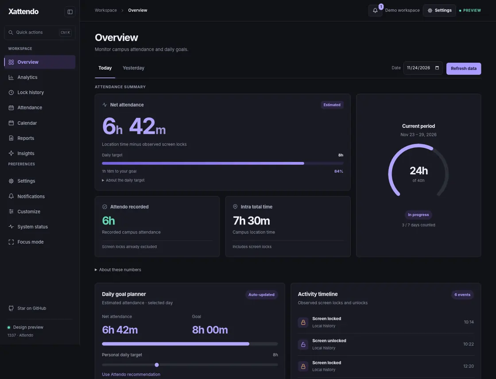
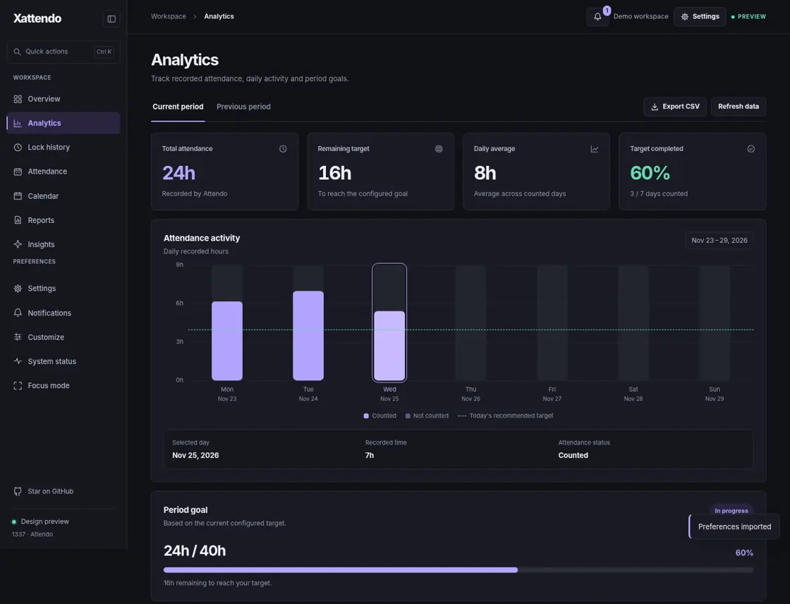
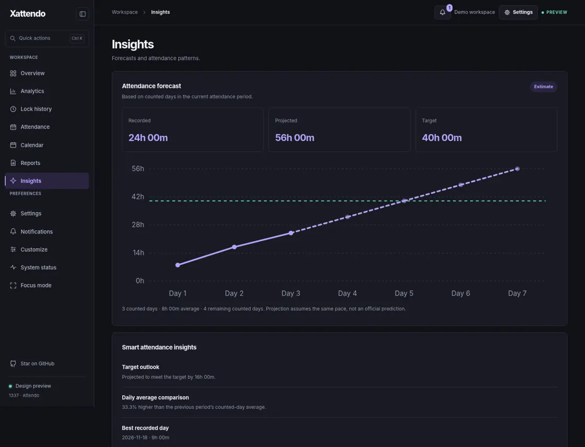
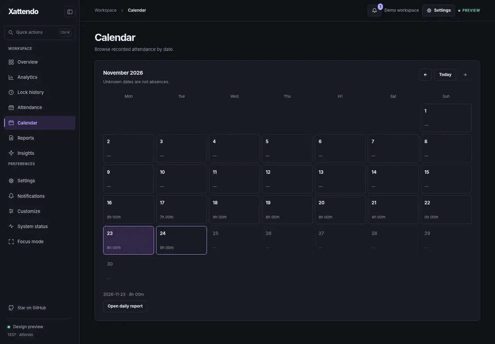
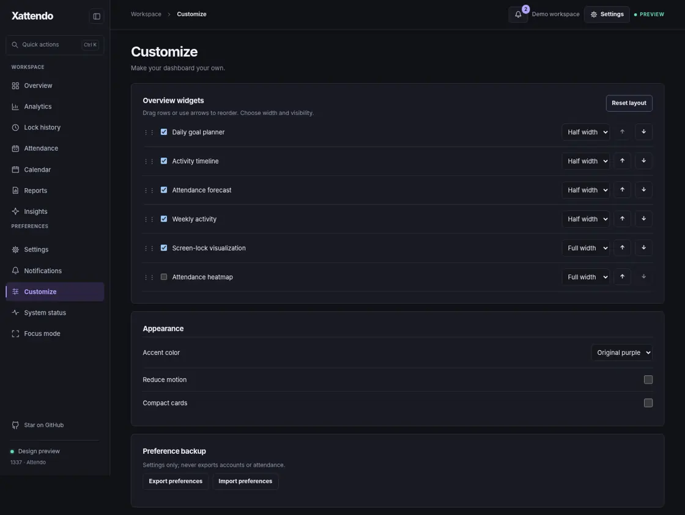
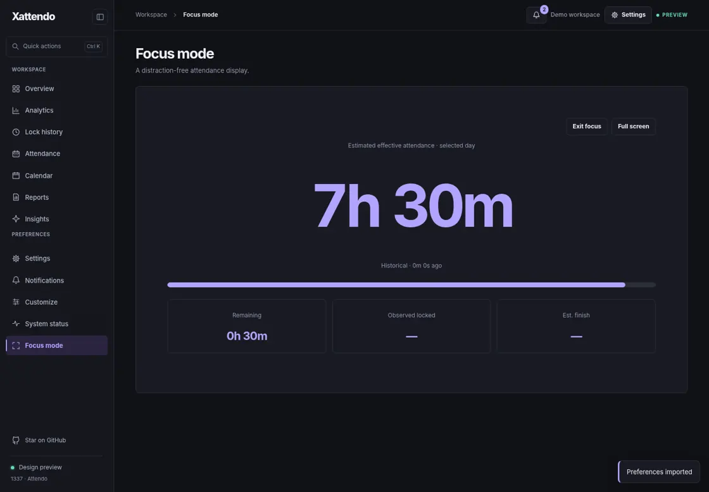

# Xattendo

A local attendance dashboard for 1337 students, with a modern purple and charcoal interface, attendance analytics, goal planning, and screen-lock history.

This fork builds on [Mohamed Nasih's original Attendo project](https://github.com/mohamednasih/attendo).

## Screenshots

The following previews use fictional attendance data.



| Analytics | Smart insights |
| --- | --- |
|  |  |
| **Calendar** | **Customize dashboard** |
|  |  |
| **Focus mode** | |
|  | |

## Features

- Overview with daily goals, period progress and activity timeline.
- Analytics with interactive charts, attendance heatmap and CSV export.
- Calendar, monthly reports, forecasts and attendance insights.
- Customizable widgets, collapsible sidebar and Ctrl+K quick actions.
- Notification center, focus mode, dark/light/system themes and responsive layouts.
- Optional offline snapshots and PWA support.
- Local attendance and screen-lock tracking through Attendo and 42 Intra.

## Get started

On Linux, with Python 3.10+ and Make installed:

```bash
git clone https://github.com/mrcholer/attendo.git
cd attendo
make install
```

The website opens automatically and checks your sessions for
[Attendo](https://attendo.1337.ma/students/login) and [42 Intra](https://profile.intra.42.fr/).
The **Account sign-in** panel shows a status for each service. Follow any **Sign in**
link in Firefox, Chrome, or Brave, then return to Xattendo. It checks automatically,
or you can click **Refresh status**. Once both accounts are signed in, the dashboard
opens.

> [!NOTE]
> **We recommend Firefox.** If you use Chrome, it may take about 30 seconds for
> your sign-in to appear in Xattendo.

You can also start the server with `ATTENDO_TOKEN` set for Attendo.

The app starts automatically when you log in and checks for updates. Keep the
project folder where you installed it.

## Use the app

Run this from any terminal to open the dashboard:

```bash
logged-time
```

To display your stats in the terminal instead:

```bash
logged-time stats
```

For a previous day, use `logged-time stats --date 2026-11-14`.

- Use the sidebar to switch between Overview, Analytics, Lock history, Attendance, Calendar, Reports, Insights, Settings and other views.
- Use **Settings** to change preferences and configure automatic refresh.
- Press `Ctrl+K` to open quick actions.
- Refresh manually whenever needed. Historical reports depend on available records; unknown dates are not assumed to be zero attendance.

Logged time for today and yesterday is an estimate that subtracts observed locks from the 42 Intra
location total. Lock history starts when the app is running; earlier locks may be
missing.

**Missing lock history?** Log in again at each workstation you previously used
and let the app run there to collect any lock records still available on that
station. Records that are no longer available cannot be recovered.

## GNOME Shell 42 extension

The redesigned top-bar menu displays net attendance, daily progress, recorded time, observed locks and current-period totals. It includes shortcuts to Profile, Session activity and Settings.

```bash
make gnome
gnome-extensions enable logged-time@local
```

If the extension is not discovered, log out and back in before enabling it. GNOME Shell 42 is the supported version. Existing extension files are refreshed by `make install`. No sudo is required.

## 42 Intra profile and session activity

The new pages use your campus identity and observed lock records. Full academic details and exact Intra location intervals require an authorized official [42 API](https://api.intra.42.fr/apidoc/2.0.html) access token. Obtain one using your own authorized application or institution-approved authorization.

In Bash, create a private token file:

```bash
mkdir -p ~/.config/xattendo
umask 077
read -rs -p '42 API access token: ' token; echo
printf '%s\n' "$token" > ~/.config/xattendo/intra-token
unset token
chmod 600 ~/.config/xattendo/intra-token
```

Alternatively set `INTRA_API_TOKEN` in the server environment. Renew an expired token and refresh the relevant page. Never commit credentials. The dashboard only returns selected profile fields, and unavailable records remain unknown rather than being counted as absences. The new features need live campus and GNOME runtime testing.

## Lock-history storage

Workstations share the SQLite database at
`~/.local/state/logged-time/history/locks.sqlite3`. Stop older JSON-writing
collectors before deploying the update. The `make` update and desktop-login
updates both import existing JSON history, verify the database, and remove the
original JSON files after the import commits. Updated collectors write directly
to SQLite.

If an import fails verification, the originals stay in place and the app
reports the error. To rerun the migration and cleanup immediately, use
`make migrate-history`. To import without removing files during that command,
run `python3 shared_history.py migrate` instead.
The older archive at `~/.local/state/logged-time/locks.sqlite3` is read separately.

## Update or uninstall

From the project folder, update and reopen the app:

```bash
make
```

To stop the app and remove its command and login startup:

```bash
make uninstall
```

Your saved lock history is kept.

## Commit messages

We generate commit messages from staged changes with [CommitGen](https://github.com/mohamednasih/commitgen-project).
